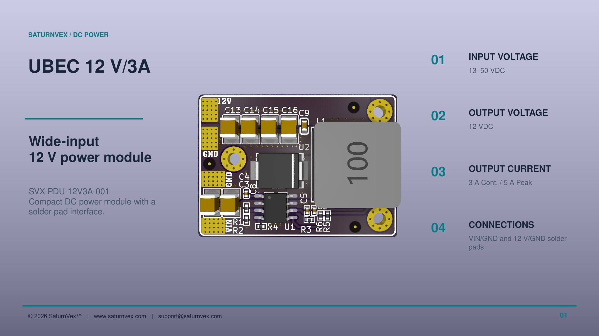
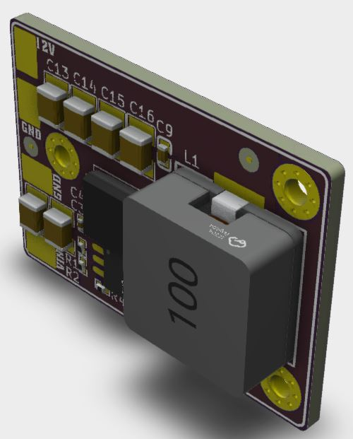

<strong>SATURNVEX · POWER UNIT</strong>

<!-- Full-width cover image; GitHub constrains content to the README panel width. -->

# SVX-PDU-12V3A — UBEC 12 V / 3 A (5 A peak)

*SaturnVex™ — embedded hardware, firmware and Edge AI platforms*

A compact wide-input DC/DC power module (UBEC) that delivers a regulated 12 V supply at 3 A continuous / 5 A peak from a 13 – 50 VDC input. Input and output connections are made through solder pads, and three mounting holes allow the module to be fixed inside the end equipment.

This is a hardware-only product: there is no firmware or source code. The repository contains the electrical verification report, the original bench photographs and the mechanical CAD data.

## Product specifications

| Item | Specification |
|---|---|
| Product code | `SVX-PDU-12V3A-001` |
| Product category | UBEC / compact DC/DC power module |
| Input voltage | 13 – 50 VDC (design specification) |
| Nominal output voltage | 12 VDC |
| Output current | 3 A continuous / 5 A peak |
| Measured efficiency at ≈ 3 A | 96.01 % (16.2 V in) · 95.13 % (28.8 V in) |
| Board dimensions | **35 × 25 mm (PCB, L × W)** |
| Connections | VIN / GND input solder pads; 12 V / GND output solder pads |
| Mounting | 3 plated mounting holes |
| Verification provided | Load test at 16.2 V and 28.8 V input, ≈ 1 – 5 A, with original bench photographs |

## Documentation

| Resource | File |
|---|---|
| **Product features & electrical verification report** | [Open PDF](docs/SaturnVex_SVX-PDU-12V3A-001_Test_Report_EN.pdf) |
| **Original bench test photographs (11)** | [Browse photos](assets/test-evidence/README.md) |
| **Mechanical CAD (35 × 25 mm)** | [CAD files / STEP](cad/README.md) |
| **Download all available documentation and CAD** | [Download complete package](downloads/SVX-PDU-12V3A-001_Complete_Resources.zip) |

## Electrical verification — measured results

Test equipment: SUNSHINE P-3005D DC power supply (input), JT6111 DC electronic load in constant-current mode (output), SIGLENT SDS 1202CNL oscilloscope (CH1 output waveform). Efficiency = Pout / Pin × 100 %.

**Rated output current: 3 A continuous, 5 A peak.** Measurement points above 3 A (≈ 4 A and ≈ 5 A) fall within the peak rating and are not continuous-operation ratings.

| Vin (V) | Iin (A) | Pin (W) | Vout (V) | Iout (A) | Pout (W) | η (%) |
|---:|---:|---:|---:|---:|---:|---:|
| 16.2 | 1.50 | 24.30 | 11.95 | 1.993 | 23.82 | 98.01 |
| 16.2 | 2.29 | 37.10 | 11.90 | 2.993 | 35.62 | 96.01 |
| 16.2 | 3.12 | 50.54 | 11.86 | 3.994 | 47.37 | 93.72 |
| 16.2 | 3.98 | 64.48 | 11.82 | 4.994 | 59.03 | 91.55 |
| 28.8 | 0.42 | 12.10 | 11.99 | 0.993 | 11.91 | 98.43 |
| 28.8 | 0.86 | 24.77 | 11.94 | 1.993 | 23.80 | 96.08 |
| 28.8 | 1.30 | 37.44 | 11.90 | 2.993 | 35.62 | 95.13 |
| 28.8 | 1.76 | 50.69 | 11.86 | 3.993 | 47.36 | 93.43 |
| 28.8 | 2.23 | 64.22 | 11.82 | 4.994 | 59.03 | 91.91 |

See the [full report](docs/SaturnVex_SVX-PDU-12V3A-001_Test_Report_EN.pdf) for the test method, interpretation and limitations, and the [photo index](assets/test-evidence/README.md) for the original bench photographs.

## CAD data

**Nominal PCB dimensions: 35 × 25 mm.** Download the original [STEP model](cad/SVX_PDU_12V3A_001.step) for mechanical integration.

## Complete download

[**Download the verification report, STEP CAD, cover image and all original test photographs**](downloads/SVX-PDU-12V3A-001_Complete_Resources.zip).

You can alternatively use **Code → Download ZIP** in GitHub to download the repository.

## Where to Buy

For availability, pricing and purchase inquiries, contact **[support@saturnvex.com](mailto:support@saturnvex.com)**.

## Notes

- The report describes a specific bench setup and its measured results, not a blanket certification claim.
- The continuous output rating is 3 A; 5 A is a peak rating. For loads that require continuous operation above 3 A, fit an additional passive heatsink to ensure continuous operation without overheating.

---
© 2026 **SaturnVex™** · [www.saturnvex.com](https://www.saturnvex.com) · support@saturnvex.com
