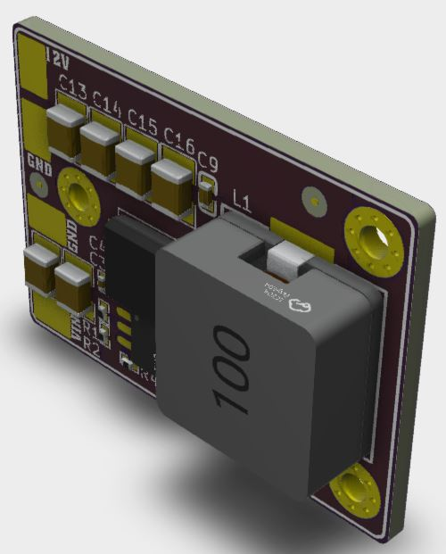

# Mechanical CAD

**PCB outline:** 35 × 25 mm (length × width). This is the nominal board footprint; PCB thickness, assembled component height and mounting-hole coordinates are not specified separately — verify the total assembly envelope (inductor, capacitors and solder-pad wiring) from the STEP model.

- [Download STEP 3D CAD model](SVX_PDU_12V3A_001.step?raw=true)
- [View CAD rendering](SVX_PDU_12V3A_001_CAD_3D_View.jpg)

[← Product home](../README.md)
